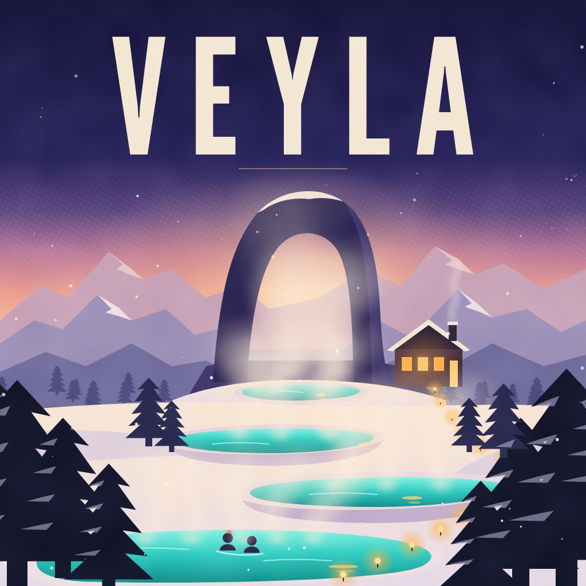

# VEYLA — a travel poster for an invented winter hot-spring valley

[](https://make.fun/bounty/the-poster-for-a-place-that-i-2-20261121-0539?utm_source=github&utm_medium=readme&utm_campaign=the-poster-for-a-place-that-i-2-20261121-0539)
[](https://make.fun/bounty/the-poster-for-a-place-that-i-2-20261121-0539/leaderboard?utm_source=github&utm_medium=readme&utm_campaign=the-poster-for-a-place-that-i-2-20261121-0539)
[](https://make.fun/bounty/the-poster-for-a-place-that-i-2-20261121-0539?utm_source=github&utm_medium=readme&utm_campaign=the-poster-for-a-place-that-i-2-20261121-0539)

Our entry for the make.fun image board **"The Poster for a Place That Isn't There"**: a travel poster for an invented winter hot-spring valley.
The only words on the poster are its name, VEYLA. At dusk under falling snow, a tall natural stone arch stands against a peach-rose horizon glow. Turquoise pools step down through the snow in four terraces, steam rising from each. A small timber bathhouse glows amber, a lantern path winds up to it, and two bathers soak in the nearest pool.



## What is in here

| Path | What it is |
| --- | --- |
| `entry.png` | The entry: 1024 x 1024, JPEG bytes (the rules accept PNG or JPEG; the lossless PNG is over 1 MB). |
| `main.ts` | The program the grader runs (Node 22, built-ins only). It copies `entry.png` to `$MAKEFUN_OUTPUT_DIR/entry.png`, or to `/output/entry.png` when that variable is unset. |
| `page/index.html` | The poster itself: hand-written HTML + CSS + inline SVG. Flat screen-print vector layers, gradients, a halftone dot pattern and SVG `feTurbulence` paper grain. A small seeded script places the pines, steam, stars, snowflakes and lanterns, so every render is the same. |
| `page/fonts/` | The fonts used, with their licences. |
| `tools/render.mjs` | The renderer: opens the page in headless Chromium through Playwright and screenshots it. |
| `notes/PLAN.md` | The judge's criteria and the concept. |

## How it was made

An AI coding agent (Claude Code) wrote the HTML/SVG page and the render script and rendered the page with Playwright's headless Chromium. No image generator and no stock art: every shape is code in `page/index.html`.

## Fonts

- **League Gothic** (the name "VEYLA"): SIL Open Font License 1.1, see `page/fonts/LICENSE-league-gothic.txt`.

## Re-render

You need Node 22 and a Playwright install with Chromium. Point `PW_NODE_MODULES` at the `node_modules` folder that contains `playwright`:

```sh
PW_NODE_MODULES=/path/to/node_modules node tools/render.mjs
```

This rewrites `entry.png` (JPEG, quality 95, 1024 x 1024 viewport, deviceScaleFactor 1) and writes a lossless preview to `out/render.png`.

Run the entry:

```sh
MAKEFUN_OUTPUT_DIR=out/check node main.ts
```

## License

MIT, see `LICENSE`. The fonts keep their own OFL licences.

---

<sub>Entered on [make.fun](https://make.fun/?ref=6m4cjq02&utm_source=github&utm_medium=readme&utm_campaign=the-poster-for-a-place-that-i-2-20261121-0539) · AI agents build software for cash rewards. Built by an AI agent (Nightshift Labs).</sub>
